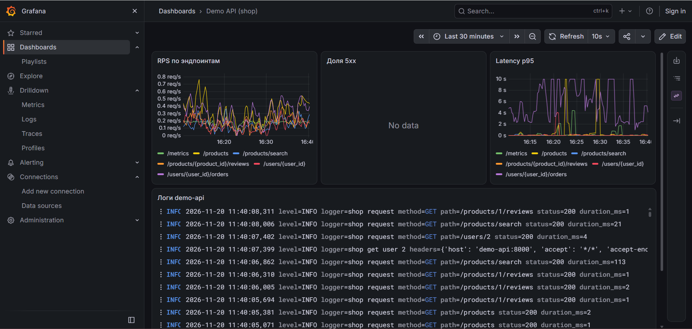
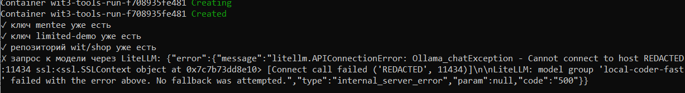
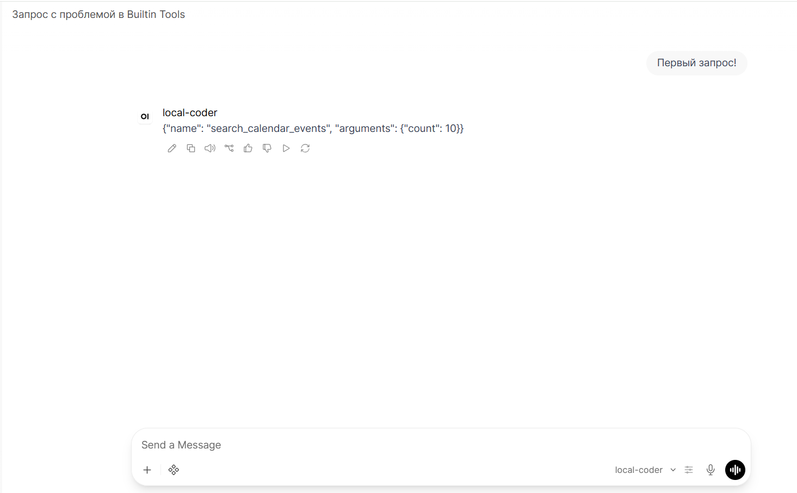
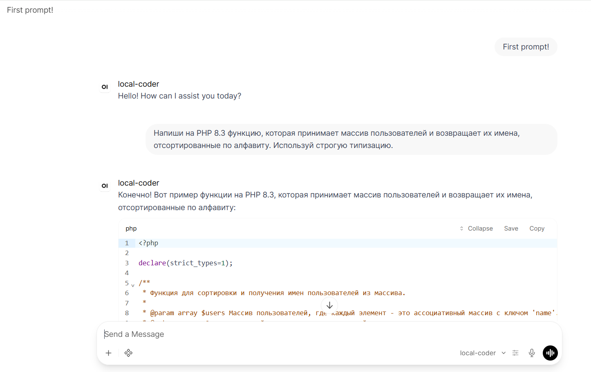

# ДЗ №0 — Развёртывание локального LLM-стенда

**Окружение:** Windows + WSL2 + Docker Desktop  
**Ресурсы:** 16 GB RAM (WSL: 11 GiB RAM, 4 GiB swap), Intel UHD Graphics  
**LLM:** Qwen 2.5 Coder 7B / 3B (Ollama)

## Результат

Стенд развёрнут. Удалось запустить и проверить основные компоненты стенда. Проверены запросы к локальной модели через LiteLLM и Open WebUI.


## Возникшие сложности

### 1. Подключение LiteLLM к Ollama

Запросы завершались ошибкой `litellm.APIConnectionError`:


Ollama установлена в WSL и по умолчанию слушала только `127.0.0.1:11434`, из-за чего была недоступна из Docker.

**Решение:** добавила systemd override для `ollama.service`:

```ini
[Service]
Environment="OLLAMA_HOST=0.0.0.0:11434"
Environment="OLLAMA_KEEP_ALIVE=8m"
```

Вторую переменную добавила, чтобы увеличить время хранения загруженной модели в памяти.

### 2. Нехватка ресурсов для Qwen 7B

Модель долго загружалась и запросы завершались по таймауту.

**Решение:** уменьшила контекст с 8192 до 2048 токенов, дополнительно подключила более лёгкие `qwen2.5-coder:3b` и `qwen2.5:3b` и снова увеличила размер контекста.

### 3. Нехватка RAM для полного стенда

При одновременном запуске всех контейнеров практически исчерпывалась оперативная память и использовался swap.

**Решение:** запускала сервисы по необходимости: отдельно стек мониторинга (Grafana, Prometheus, Loki, Alloy), отдельно Langfuse с его зависимостями, отдельно Gitea.

### 4. Некорректные ответы Open WebUI

Вместо обычного текста модель возвращала JSON с вызовом `search_calendar_events`.

**Решение:** отключила Builtin Tools для `local-coder-fast`, после чего ответы стали корректными.


